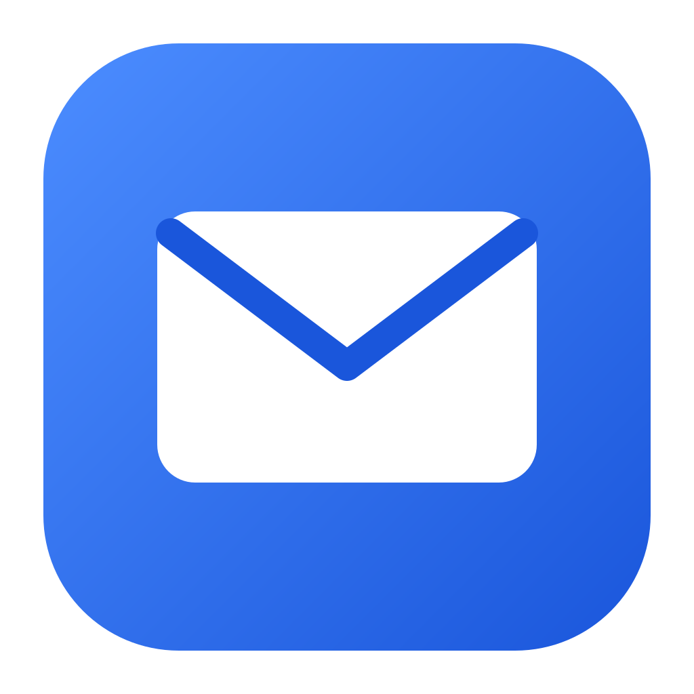
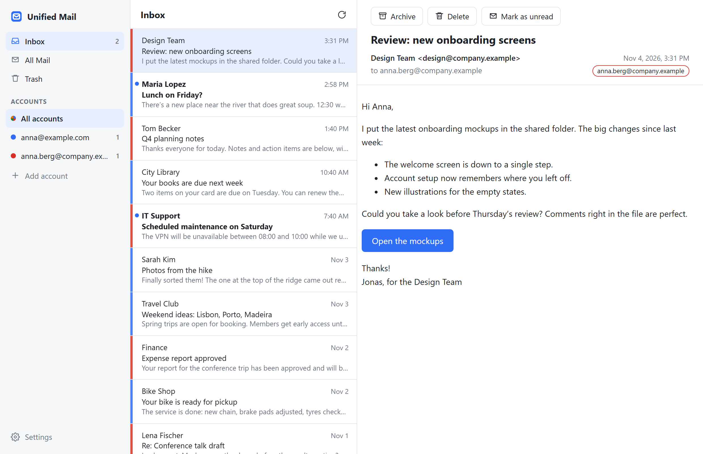

#  Unified Mail

A small, fast desktop email app for Gmail on Windows and macOS: one inbox for all your Gmail accounts.

- **Inbox, Sent, Drafts, All Mail and Trash** for all your accounts together, or for one account at a time
- **Search** all your accounts at once, with Gmail's search words such as `from:` and `has:attachment`
- **Write, reply and forward** from any of your accounts, with attachments, and **Undo** for a few seconds after you click Send. Drafts are saved to your Gmail Drafts as you type
- **New mail appears within seconds**, with no need to refresh, and a **notification** tells you about it when the app is in the background
- The **unread count** shows on the app's taskbar / Dock icon
- **Updates itself:** when a new version is out, Settings shows an **Update** button, and one click installs it
- Light or dark look, or follow the system (Settings → Appearance). In dark mode emails are dark too, with one click back to their original colors
- **Archive**, **Delete** (to Trash) and **Move to Inbox**, each with **Undo**
- **Mark as unread** to come back to a message later
- **Phishing checks:** point at a link to see where it goes, and a link that shows one site but goes to another asks before it opens. Attachments show their real type, and the reader says when replies would go to someone other than the sender
- Point at a message in the list for quick **Archive**, **Delete** and **Mark as unread** buttons, or right-click it for its actions
- Older mail loads as you scroll
- The installer is about 1.5 MB, and the app starts instantly

<picture>
  <source media="(prefers-color-scheme: dark)" srcset="docs/images/screenshot-dark.png">
  
</picture>

## Download

Get the latest version from the **[Releases page](https://github.com/andeliseev/unified-mail/releases/latest)**. What changed in each version is in the [changelog](CHANGELOG.md).

| System | File |
| --- | --- |
| Windows 10 / 11 | `Unified.Mail_<version>_x64-setup.exe` (or the `.msi`) |
| macOS (Apple Silicon and Intel) | `Unified.Mail_<version>_universal.dmg` |

### First launch

The app isn't code-signed yet, so your system asks once before opening it:

- **Windows:** "Windows protected your PC" → **More info** → **Run anyway**.
- **macOS:** open the app, then go to **System Settings → Privacy & Security** and click **Open Anyway**. The app keeps your sign-ins in the keychain. If macOS asks for your password to let Unified Mail use it, enter it and click **Always Allow**. Updates you install from the app don't ask again; a version installed from a downloaded `.dmg` asks once more for each account. The first time you save an attachment, macOS also asks whether Unified Mail may access your Downloads folder: click **Allow**.

## Adding your Gmail accounts

Click **Add account**, choose your Google account in the browser window that opens, and click **Allow**. Repeat for each account.

- Google may warn that **"Google hasn't verified this app"**, because the app hasn't finished Google's review yet. Click **Advanced → Go to Unified Mail** to continue.
- **Work accounts (Google Workspace):** your administrator may block apps that Google hasn't verified. If sign-in is refused, ask them to allow Unified Mail.
- Google's permission screen asks for full Gmail access. Gmail requires that for instant new-mail notifications. The app reads your mail, sends the emails you write and keeps their drafts in your Gmail Drafts, marks mail read or unread, archives it, and moves it to or from Trash. It never permanently deletes anything except drafts you discard or send.

## Keyboard shortcuts

| Key | Action |
| --- | --- |
| `J` / `K` or `↓` / `↑` | Next / previous message |
| `Space` / `PageDown`, `PageUp` | Scroll the open message |
| `E` | Archive |
| `#` or `Delete` | Delete (move to Trash) |
| `Shift+U` / `Shift+I` | Mark as unread / read |
| `Z` | Undo |
| `/`, or `Cmd+F` on a Mac and `Ctrl+F` on Windows | Search |
| `C` | New message |
| `R` / `A` / `F` | Reply / Reply all / Forward |
| `Cmd+Enter` on a Mac, `Ctrl+Enter` on Windows | Send, while writing |
| `Esc` | Close the search |

## Privacy

Unified Mail runs entirely on your computer and talks only to Google, plus GitHub to check for updates. There are no servers of ours, no analytics and no tracking.

- **Sign-ins** are kept in your system's secure storage: Windows Credential Manager or macOS Keychain. While an update installs on a Mac, they're passed to the new version in a file only your user account can read, which the new version deletes as it starts.
- **Message lists** are cached in the app's data folder so the app opens instantly. Message content isn't saved, except attachments you save, which go to your Downloads folder. Pictures an email loads from the internet stay in the system web view's cache, as in a browser.
- **Emails you write** are saved as drafts in the account's Gmail Drafts as you type, and sent from Gmail when you click Send. They're not saved on your computer.
- **Updates:** when it starts, every few hours, and when you open Settings, the app downloads a small file from GitHub to see whether a new version is out. GitHub sees your IP address, nothing else. An update installs only when you click **Update** in Settings, and only if it's signed by the developer.
- **Notifications** show the sender and subject of new mail. Windows and macOS keep recent notifications in their notification center until you clear them.
- **Removing an account** in Settings deletes its sign-in and its data from this computer. It stays signed in on your other computers: to take back the app's access everywhere, use [Third-party apps](https://myaccount.google.com/permissions) in your Google Account.
- **Email content** is shown with scripts and forms blocked, and links open in your browser.

Read the full [privacy policy](https://andeliseev.github.io/unified-mail/privacy.html).

## Current limits

- Gmail only for now. Other providers, such as Yandex Mail, are planned.
- Drafts are plain text: a draft started in Gmail with bold text or pictures loses that formatting once you edit it here.
- Older messages you've scrolled to aren't refreshed in the background. Reopen the folder to update them.

## Building from source and contributing

The app is built with [Tauri 2](https://v2.tauri.app/): a Rust backend plus your system's own web view, with no bundled browser. To build it yourself, including the one-time Google Cloud setup, see [docs/development.md](docs/development.md). How it works inside is in [docs/](docs/README.md).

Bug reports and pull requests are welcome. To report a security problem, see [SECURITY.md](SECURITY.md).

## License

[MIT](LICENSE)
