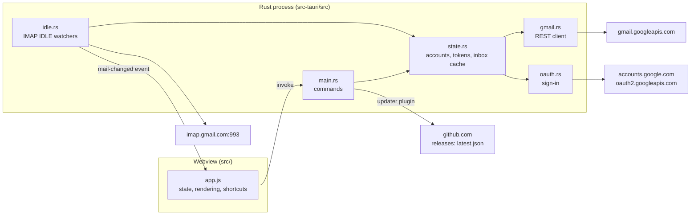

# Architecture

Unified Mail is a [Tauri 2](https://v2.tauri.app/) app. A Rust process owns all network access, tokens and storage. The UI is static HTML/CSS/JS rendered by the operating system's webview (WebView2 on Windows, WKWebView on macOS). The UI talks to Rust only through Tauri commands and events.

## Rust modules

| Module | Responsibility |
| --- | --- |
| `main.rs` | Tauri setup (it creates the window, in the saved theme), command handlers, starting push watchers at launch, notifications and the icon badge, and on macOS keeping the app running when the window is closed |
| `state.rs` | `AppState`: OAuth client, account list, access-token cache, inbox cache, file persistence, and on macOS handing the sign-ins over to an update |
| `keychain.rs` | Sign-ins in the system keychain: the macOS keychain through the Security framework, saving each as a new item so updates read it without asking, and Windows Credential Manager through `keyring` (see [auth.md](auth.md#macos-keychain)) |
| `gmail.rs` | Gmail REST calls (list, metadata, full message, archive, trash, mark read/unread, attachments, send, drafts), MIME body selection and the list of attachments |
| `mime.rs` | Writes the emails the app sends: headers (encoded words for text outside ASCII, nothing a field can turn into a header of its own), quoted-printable text and HTML, base64 files, and the parts they nest in (see [Sending](#sending)) |
| `files.rs` | Saving attachments: safe file names, never replacing a file, marking files as coming from email, showing them in Finder or File Explorer (see [ui.md](ui.md#attachments)) |
| `oauth.rs` | Installed-app OAuth: system browser, loopback redirect, PKCE, token exchange, refresh, revoke |
| `idle.rs` | One long-lived IMAP IDLE connection per account; emits `mail-changed` |
| `macos.rs` | macOS only: opens links clicked in the email in the browser, and passes right-clicks and keys in it on to the page, since WebKit doesn't run the page's handlers in the sandboxed frame (see [ui.md](ui.md#sandbox)). Tells the page when the window enters or leaves full screen (see [ui.md](ui.md#title-bar)). Gives saved attachments macOS's quarantine mark (see [ui.md](ui.md#attachments)). After an update, opens the app again once the old copy has quit (see [development.md](development.md#updates)) |
| `build.rs` | Embeds the Google OAuth client at compile time (see [auth.md](auth.md)) |

## Commands (UI → Rust)

All return `Result<_, String>`. The string is shown to the user as is, so error messages are written for people.

| Command | Args | Returns |
| --- | --- | --- |
| `get_setup` | | `{ builtInClient, clientId, accounts }` |
| `save_client` | `clientId, clientSecret` | Only used when no client is built in |
| `add_account` | | Email address; runs the browser sign-in and starts push |
| `reconnect_account` | `email` | Email address; signs in again to an expired account (preselected in Google's chooser), restarts its push. Fails if another account is chosen |
| `remove_account` | `email` | Stops push, revokes the token, deletes it from the keychain |
| `cached_folder` | `folder` | Last saved snapshot of `inbox`, `sent`, `drafts`, `all` or `trash`, for instant first paint |
| `refresh_folder` | `folder` | `{ messages, errors, more }`: each account's newest page; errors per account (`{ account, message, expired }`, `expired` for a sign-in Google no longer accepts); `more[account]` says whether older mail exists |
| `load_older` | `folder, account, before` | `{ messages, more, inbox, warning }`: the account's next 50 messages older than `before` (ms); `inbox` lists which are in the Inbox (All Mail only) |
| `search_messages` | `account, query, before` | The same as `load_older`, for the account's All Mail messages matching `query` (Gmail's search syntax): the newest 50, or with `before` (ms) the next 50 older ones (see [sync.md](sync.md#search-appstatesearch)) |
| `get_message` | `account, id` | Headers, HTML/text body and `attachments` (`{ part, name, mimeType, size, contentId }`). It doesn't change the message; the UI then calls `set_unread` |
| `inline_images` | `account, id, parts` | The pictures the email shows in place (`cid:` links): `[{ part, mimeType, data }]`, data as base64url (see [ui.md](ui.md#pictures-in-the-email-cid-links)) |
| `save_attachments` | `account, id, parts, job, onProgress` | Saves those attachments (Gmail part IDs) to the Downloads folder under names no file there has, marked as coming from email; returns their paths, or none when cancelled. Meanwhile the `onProgress` channel gets the bytes arrived so far, up to ten times a second (see [ui.md](ui.md#attachments)) |
| `cancel_save` | `job` | Stops that `save_attachments` if it's still downloading |
| `send_message` | `job, delayMs, draft` | Sends an email written in the app (see [Sending](#sending)) after `delayMs`, the time its Undo shows; returns its id, or null when `cancel_send` stopped it |
| `cancel_send` | `job` | Undo for `send_message`: whether it was stopped in time |
| `save_draft` | `draft` | Saves what's written as a Gmail draft of `draft.account`: a new one, or `draft.draftId` updated; returns `{ id, messageId, threadId }` (see [ui.md](ui.md#drafts-in-gmail)) |
| `delete_draft` | `account, id` | Deletes that Gmail draft for good (Discard); one already gone is fine |
| `open_draft` | `account, id` | That Gmail draft to go on writing: `{ id, messageId, threadId, to, cc, bcc, subject, inReplyTo, references, text, html, files, answered }`, files with their data (base64) and `answered` the summary of the email it answers, when found |
| `show_in_folder` | `paths` | Shows saved attachments in Finder or File Explorer; only files in the Downloads folder |
| `set_unread` | `account, id, unread` | Marks the message read (on opening, Mark as read) or unread (Mark as unread) |
| `archive_message` | `account, id` | Removes the `INBOX` label |
| `trash_message` | `account, id` | Moves the message to Trash; returns `{ wasInInbox }` for Undo |
| `restore_message` | `account, id, fromTrash, toInbox` | Takes it out of Trash and/or adds `INBOX`: Undo, and "Move to Inbox" |
| `set_theme` | `theme` | `system`, `light` or `dark`: sets the window's theme and saves it in `settings.json` |
| `set_list_width` | `width` | The message list's width in px, dragged by the user, saved in `settings.json`; null goes back to the default |
| `open_external` | `url` | Opens `http(s):`/`mailto:` links in the default app |

Two more commands are for the [new-mail alerts](ui.md#notifications-and-the-icon-badge):

| Command | Args | Returns |
| --- | --- | --- |
| `notify` | `title, body, account?, id?` | Shows a desktop notification; clicking it opens that message |
| `set_badge` | `count, icon, size` | Unread count on the app icon: Dock badge on macOS; on Windows `icon` (RGBA, `size`×`size`, drawn by the UI) becomes the taskbar overlay icon |

Events (Rust → UI):
- `mail-changed`, with the account email as payload.
- `open-message`, `{ account, id }` or null, when a notification is clicked.
- macOS only, from `macos.rs`: `email-context-menu`, `[x, y]` in the window, for a right-click in the email; `email-key`, `[key, code, shift]`, for every key pressed without Cmd, Ctrl or Option; and `full-screen`, `true` or `false`, when the window enters or leaves full screen.

And two for [updates](development.md#updates):

| Command | Args | Returns |
| --- | --- | --- |
| `check_update` | | The newer version on GitHub, or null. The found update is kept in `PendingUpdate` |
| `install_update` | | Downloads it, checks its signature against `plugins.updater.pubkey`, installs it and restarts. On Windows the app exits and the installer starts it again; on macOS the app quits and `macos.rs` opens it again once it's gone |

Plugins:
- `tauri-plugin-notification`: Windows toasts and macOS notifications.
- `tauri-plugin-single-instance`: keeps one copy of the app running; launching it again just brings the window forward.
- `tauri-plugin-updater`: used only from Rust, so it needs no capability permissions.

## Sending

The page hands `send_message` (and `save_draft`) a draft: `account`, `to`/`cc`/`bcc` as `{ name, email }`, `subject`, `text`, `html` (answers only), `answers` (`{ id, threadId, messageId, references }` of the email answered), `files` picked on the computer or kept from a Gmail draft (`{ name, mimeType, data }`, base64), `parts` of the email answered that go along (a forward's files; the pictures its quoted HTML shows, with their `contentId`), and `draftId`, the Gmail draft it's saved as.

- **Undo waits in Rust.** `send_message` registers its `job` in the `Outbox` and waits `delayMs` (capped at 30 s) unless told otherwise: `cancel_send` says never, and the toast's Undo shows the message again. The wait is `biased` toward being told, so an Undo arriving as the time runs out still stops it.
- **Quitting sends what's waiting.** `on_event` catches `RunEvent::Exit`, which comes however the app ends, `Cmd+Q` on macOS and closing the window on Windows included. `Outbox::flush` tells every waiting email to go now and waits up to 20 s for them all to be sent. `install_update` does the same once the update has downloaded, just before installing it, since installing ends the app without that event (on Windows the installer ends the process): an email sent while it downloaded goes too.
- **A saved draft goes as itself:** with `draftId`, `AppState::send` saves the draft once more with what was last written, then `drafts.send` sends it, which moves it to Sent; without one, `messages.send` sends a new message. Saving first means a failed send leaves the draft with the latest text.
- **Writing the email** (`AppState::write_email`, also for `save_draft`, which skips the check and leaves out recipients that would break a header): `mime::Email::check` comes first (someone to send to, every address an address, at most 25 MB of files), so a mistake fails before anything downloads. Then the parts that go along are fetched from Gmail (`gmail::get_files`), and kept in memory (`AppState::parts`, up to 64 MB) since a draft is saved again and again with them, and `mime.rs` writes the email: Date, To/Cc/Bcc, Subject, In-Reply-To and References for answers, then `text/plain`, with `text/html` in `multipart/alternative`, pictures in `multipart/related`, files in `multipart/mixed`. From is the account with the name Gmail sends it under (Settings → Accounts → Send mail as, read by `gmail::display_name` once per launch): without a From header, Gmail is reported to put the address alone. When no name is set there, or it can't be read, From is left to Gmail. Gmail adds the Message-ID, and keeps Bcc out of what recipients get.
- **Gmail's upload endpoint** (`gmail::upload`: `POST /upload/gmail/v1/users/me/messages/send`, `POST …/drafts`, `PUT …/drafts/{id}`, all `?uploadType=multipart`): a JSON part with the `threadId`, so an answer joins its conversation, then the email as `message/rfc822`. It takes emails up to 35 MB, while the email base64-encoded in a JSON body would be a third larger. The upload gets the long attachment timeout.
- Drafts are saved in Gmail, not on the computer (see [ui.md](ui.md#drafts-in-gmail)). A save that fails because the draft was deleted meanwhile (404) makes a new draft.

## Storage

| Data | Where | Format |
| --- | --- | --- |
| Refresh tokens | OS keychain, service `unified-mail`, user = email; read once per launch, then kept in memory | keychain.rs |
| Refresh tokens during an update (macOS) | `<app data>/sign-ins-for-update.json`, mode 0600, from just before the install until the new version starts (see [auth.md](auth.md#macos-keychain)) | JSON object, email → token |
| Access tokens | Memory only | Expire 60 s early; wall clock, see below |
| OAuth client (Settings fallback) | `<app data>/client.json` | JSON |
| Account list | `<app data>/accounts.json` | JSON array of emails |
| Settings (appearance, list width) | `<app data>/settings.json` | `{ "theme": "system", "list_width": 320 }`; missing fields get defaults |
| Folder snapshots | `<app data>/inbox-cache.json`, `sent-cache.json`, `drafts-cache.json`, `all-cache.json`, `trash-cache.json` | JSON array of `MessageSummary` |

`<app data>` is `%APPDATA%\com.andeliseev.unified-mail` on Windows and `~/Library/Application Support/com.andeliseev.unified-mail` on macOS. The test app (`npm run dev`) uses `com.andeliseev.unified-mail.devtest` instead (see [development.md](development.md#testing-without-your-own-mail)). Files are written to a temp file of their own (`<name>.<n>.tmp`) and then renamed, so a crash can't leave a half-written file, and two writes of the same file at once (a sync and an action saving a folder's cache) can't mix.

Up to 0.1.11 the identifiers were `io.unifiedmail.desktop` and `io.unifiedmail.devtest`. At startup, before the data is read or the window opens, the app renames the earlier data folder to the new name, unless the new folder already has files, and then deletes the webview cache the earlier name left (`%LOCALAPPDATA%\<identifier>` on Windows, `~/Library/Caches/<identifier>` and `~/Library/WebKit/<identifier>` on macOS). When Windows won't rename the folder because a file in it is open, the app copies the files and leaves the earlier folder. `bundle.publisher` stays `unifiedmail`, which Tauri used to take from the earlier identifier: the Windows installer remembers the install folder in the registry under that name, so updates still find a folder the user chose.

## Design decisions

- **No frontend framework, no bundler.** `src/` is served as is (`frontendDist`). Fewer dependencies, nothing to build, tiny assets.
- **Use what the OS already ships.** Webview instead of bundled Chromium; `native-tls` (SChannel / Secure Transport) instead of rustls, for the updater too (its default features would add rustls and zip, +1.4 MB); the webview's `TextDecoder` for legacy charsets instead of `encoding_rs`. All of this keeps the binary small (see [development.md](development.md)).
- **Locks are never held across `.await`.** `AppState` uses `std::sync::Mutex`, locked only for quick in-memory reads and writes. Network calls happen outside the lock, and Tauri async commands must be `Send`.
- **Access-token expiry uses `SystemTime`, not `Instant`.** On macOS `Instant` stops while the machine sleeps, which would leave expired tokens looking valid.
- **Errors are `String`s.** Every failure ends up as a message in the UI, so a typed error enum would add code without adding value yet.
- **Message ids are checked.** They go into URL paths, so `gmail.rs` accepts only alphanumeric ids.
