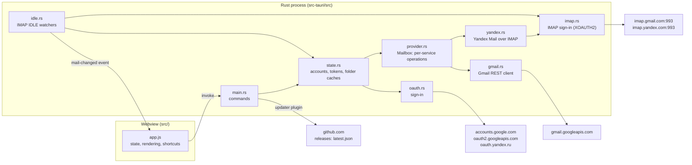

# Architecture

Unified Mail is a [Tauri 2](https://v2.tauri.app/) app. A Rust process owns all network access, tokens and storage. The UI is static HTML/CSS/JS rendered by the operating system's webview (WebView2 on Windows, WKWebView on macOS). The UI talks to Rust only through Tauri commands and events.

## Rust modules

| Module | Responsibility |
| --- | --- |
| `main.rs` | Tauri setup (it creates the window, in the saved theme), command handlers, starting push watchers at launch, notifications and the icon badge |
| `state.rs` | `AppState`: OAuth client, account list, access-token cache, folder caches, expired sign-ins, file persistence, keychain. Knows nothing of Gmail's labels or API: it asks the account's `Mailbox` |
| `provider.rs` | The app's mail vocabulary (`Folder`, `MessageSummary`, `FullMessage`), the `Provider` an account belongs to (`Gmail`, `Yandex`), and `Mailbox`: a folder page with its unread ids, summaries, full message, read/unread, archive, trash, restore. Each operation matches on the provider |
| `gmail.rs` | Gmail through its REST API: folders as label filters, list, metadata, full message, archive, trash, restore, mark read/unread, and MIME body selection |
| `yandex.rs` | Yandex Mail over IMAP: folders, pages by UID, summaries from `ENVELOPE` and `BODYSTRUCTURE`, a body part by section with its transfer encoding undone, `\Seen`. Ids are `<folder letter><UIDVALIDITY>.<UID>`. Archive, Delete and Undo aren't done yet. See [auth.md](auth.md#yandex) |
| `imap.rs` | An IMAP connection over TLS (each `Server` says whether to stay on TLS 1.2, as Yandex does), signed in with an OAuth token (XOAUTH2, Gmail) or a password (LOGIN, Yandex's app password); used by push and by `yandex.rs` |
| `oauth.rs` | Google's installed-app OAuth: system browser, loopback redirect, PKCE, token exchange, refresh, revoke, and Cancel |
| `idle.rs` | One long-lived IMAP IDLE connection per account; emits `mail-changed` |
| `build.rs` | Embeds the Google OAuth client at compile time (see [auth.md](auth.md)) |

## Commands (UI → Rust)

All return `Result<_, String>`. The string is shown to the user as is, so error messages are written for people.

| Command | Args | Returns |
| --- | --- | --- |
| `get_setup` | | `{ builtInClient, clientId, accounts, providers, theme }`; `providers[email]` is `gmail` or `yandex` |
| `save_client` | `clientId, clientSecret` | Only used when no client is built in |
| `add_account` | | Email address; runs Google's sign-in in the browser for a new Gmail account and starts push |
| `add_yandex_account` | `email, password` | Email address; checks the address and app password with Yandex's IMAP server, saves them and starts push. For an added account it replaces the password (Reconnect) |
| `reconnect_account` | `email` | Email address; signs in again to an expired account (preselected in Google's chooser), restarts its push. Fails if another account is chosen |
| `cancel_sign_in` | | Stops a Google sign-in waiting for the browser (the overlay's Cancel) |
| `remove_account` | `email` | Stops push, revokes the token, deletes it from the keychain |
| `cached_folder` | `folder` | Last saved snapshot of `inbox`, `all` or `trash`, for instant first paint |
| `refresh_folder` | `folder` | `{ messages, errors, more }`: each account's newest page; errors per account (`{ account, message, expired }`, `expired` for a sign-in Google no longer accepts); `more[account]` says whether older mail exists |
| `load_older` | `folder, account, before` | `{ messages, more, inbox, warning }`: the account's next 50 messages older than `before` (ms); `inbox` lists which are in the Inbox (All Mail only) |
| `get_message` | `account, id` | Headers plus HTML/text body. It doesn't change the message; the UI then calls `set_unread` |
| `set_unread` | `account, id, unread` | Marks the message read (on opening, Mark as read) or unread (Mark as unread) |
| `archive_message` | `account, id` | Removes the `INBOX` label |
| `trash_message` | `account, id` | Moves the message to Trash; returns `{ wasInInbox }` for Undo |
| `restore_message` | `account, id, fromTrash, toInbox` | Takes it out of Trash and/or adds `INBOX`: Undo, and "Move to Inbox" |
| `set_theme` | `theme` | `system`, `light` or `dark`: sets the window's theme and saves it in `settings.json` |
| `open_external` | `url` | Opens `http(s):`/`mailto:` links in the default app |

Two more commands are for the [new-mail alerts](ui.md#notifications-and-the-icon-badge):

| Command | Args | Returns |
| --- | --- | --- |
| `notify` | `title, body, account?, id?` | Shows a desktop notification; clicking it opens that message |
| `set_badge` | `count, icon, size` | Unread count on the app icon: Dock badge on macOS; on Windows `icon` (RGBA, `size`×`size`, drawn by the UI) becomes the taskbar overlay icon |

Events (Rust → UI):
- `mail-changed`, with the account email as payload.
- `open-message`, `{ account, id }` or null, when a notification is clicked.

And two for [updates](development.md#updates):

| Command | Args | Returns |
| --- | --- | --- |
| `check_update` | | The newer version on GitHub, or null. The found update is kept in `PendingUpdate` |
| `install_update` | | Downloads it, checks its signature against `plugins.updater.pubkey`, installs it and restarts. On Windows the app exits and the installer starts it again |

Plugins:
- `tauri-plugin-notification`: Windows toasts and macOS notifications.
- `tauri-plugin-single-instance`: keeps one copy of the app running; launching it again just brings the window forward.
- `tauri-plugin-updater`: used only from Rust, so it needs no capability permissions.

## Storage

| Data | Where | Format |
| --- | --- | --- |
| Refresh tokens (Gmail), app passwords (Yandex) | OS keychain, service `unified-mail`, user = email | `keyring` crate |
| Access tokens | Memory only | Expire 60 s early; wall clock, see below |
| OAuth client (Settings fallback) | `<app data>/client.json` | JSON |
| Account list | `<app data>/accounts.json` | JSON array: a Gmail account is its email as a string (as before providers existed); another service's account would be `{ "email", "provider" }`. Entries this version can't read are skipped, not fatal |
| Settings (appearance) | `<app data>/settings.json` | `{ "theme": "system" }`; missing fields get defaults |
| Folder snapshots | `<app data>/inbox-cache.json`, `all-cache.json`, `trash-cache.json` | JSON array of `MessageSummary` |

`<app data>` is `%APPDATA%\io.unifiedmail.desktop` on Windows and `~/Library/Application Support/io.unifiedmail.desktop` on macOS. The test app (`npm run dev`) uses `io.unifiedmail.devtest` instead (see [development.md](development.md#testing-without-your-own-mail)). Files are written to a `.tmp` file and then renamed, so a crash can't leave a half-written file.

## Design decisions

- **No frontend framework, no bundler.** `src/` is served as is (`frontendDist`). Fewer dependencies, nothing to build, tiny assets.
- **Use what the OS already ships.** Webview instead of bundled Chromium; `native-tls` (SChannel / Secure Transport) instead of rustls, for the updater too (its default features would add rustls and zip, +1.4 MB); the webview's `TextDecoder` for legacy charsets instead of `encoding_rs`. All of this keeps the binary small (see [development.md](development.md)).
- **Locks are never held across `.await`.** `AppState` uses `std::sync::Mutex`, locked only for quick in-memory reads and writes. Network calls happen outside the lock, and Tauri async commands must be `Send`.
- **Access-token expiry uses `SystemTime`, not `Instant`.** On macOS `Instant` stops while the machine sleeps, which would leave expired tokens looking valid.
- **Errors are `String`s.** Every failure ends up as a message in the UI, so a typed error enum would add code without adding value yet.
- **Message ids are checked.** They go into URL paths, so `gmail.rs` accepts only alphanumeric ids, and `yandex.rs` parses its own format before using one.
- **Mail services are an enum, not a trait object.** `Provider` lists the services and every `Mailbox` operation matches on it. That needs no `dyn`/`async-trait` machinery, and adding a service makes the compiler point at every operation it must implement. Ids stay opaque strings to `state.rs` and the UI.
